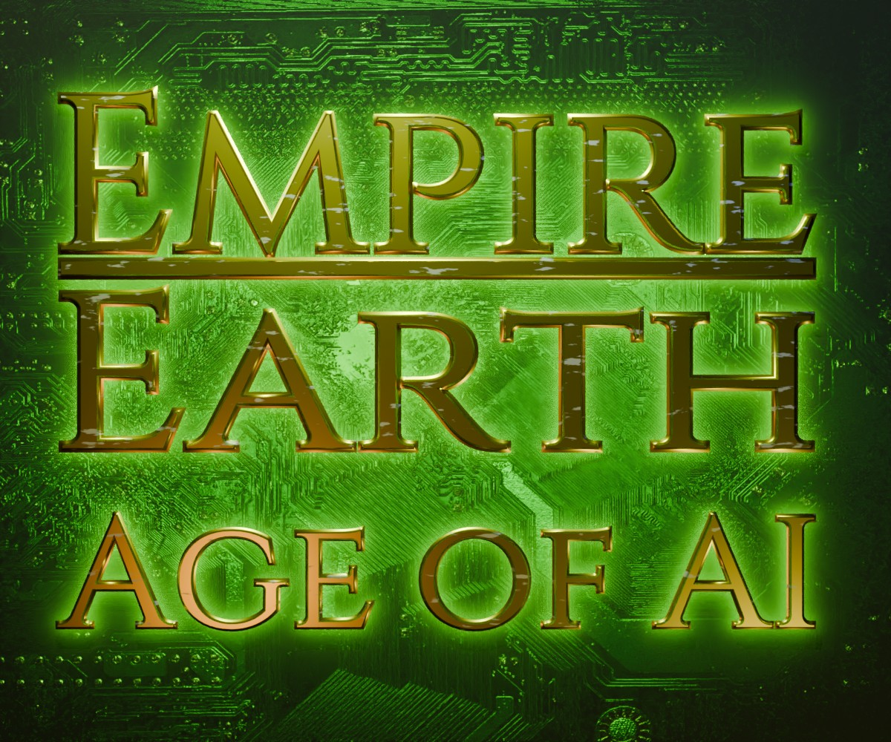
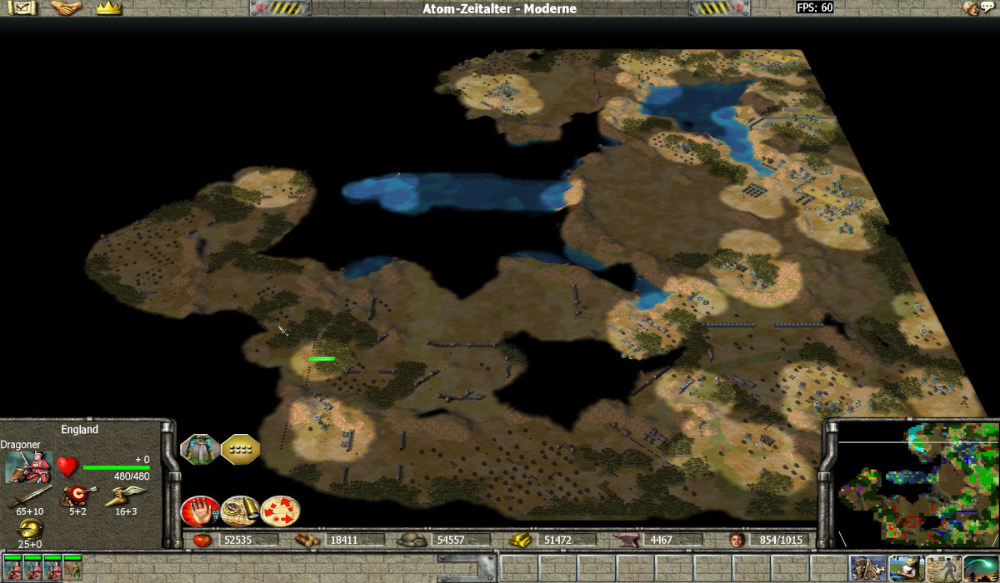
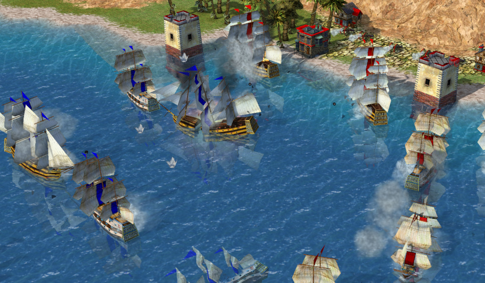
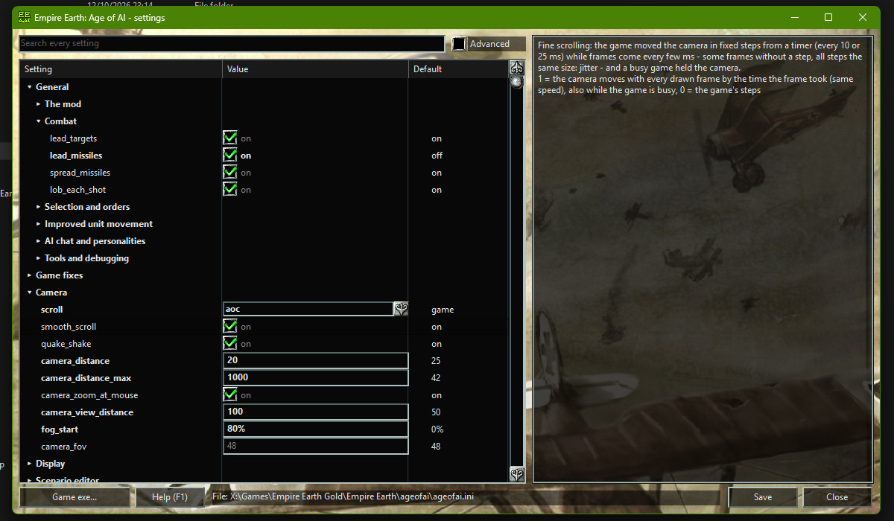

*An unofficial fan mod. Not affiliated with or endorsed by the rights holders of Empire Earth.*

## Human Foreword 

This started as an experiment since I heard that Claude is very good at reverse engineering... well, that turned out the be a bit of an understatement, the fucking thing walks through binaries like its open code. 

Since Empire Earth was one of my favorite (yet flawed) games since childhood, it was a prime target to aim this new technology at.

The result of more than a month of full-time work by now, is a near full overhaul, no part of the game is untouched: 

- Old bugs fixed. 
- All new non cheating AI 
- Improved Graphics (subtle changes that don't touch the vibe of the game) 
- Quality of live improvements. 
- New bugs to find and enjoy 

This project is still very WIP, and while most of my own time spend on this is QA, some issues surely slipped through (or are known but low on the list of things to work on) 

If you encounter a problem or want to suggest something, feel free to open an issue

## Introduction
**Computer players worth playing against.** The original Empire Earth AI only keeps up because it cheats: it pays
about 1% of the real prices. Take that away and it can't run an economy. Age of AI gives the computer players a
brain of their own - they pay what you pay, see only what you could see, and still build, expand, defend and attack
like a player. On top of that the mod fixes and modernizes the game itself: windowed mode, a camera that zooms out
further, big selections, smoother movement and much more.

It is a single DLL dropped into the game folder; the game's own files stay untouched. It works with
**Empire Earth 1.04** (GOG, Steam Gold Edition, NeoEE) and **The Art of Conquest**.

The name says it twice: the computer players are the heart of the mod, and the mod itself exists because of AI -
the game's code was reverse-engineered and the mod written largely with AI coding tools.

## Highlights

### An AI that plays fair

- **No cheating.** The AI pays full price and knows only what it has scouted - enemy buildings it has seen, armies
  it has spotted.
- **It thinks in territories.** The map is split into regions. The AI works the land it holds, guards its borders,
  builds a Settlement and a tower by every mine, and sends soldiers where they are needed rather than leaving them in
  one heap.
- **A real economy.** Citizens gather where it is safe and stay at their gold and iron until they are actually
  attacked. Farms, houses for morale, researched upgrades and epochs at a sensible pace.
- **It fights like a player.** It pushes when it is winning and pulls back when it isn't. It brings siege against
  defences and uses priests to convert lone units. Prophets bring towers down with an earthquake cast from out of
  range.
- **It understands scenarios.** In a scenario the AI follows the trigger system's attack and defend targets and
  respects the AI settings the map gives it.

### Diplomacy and personalities

- The AIs answer when you declare war, make peace and alliances, capitulate and sometimes betray you. They remember
  it all across save and load.
- Each AI has a personality and talks in the chat in its own voice. Optionally a language model running on your own
  PC lets you actually chat with them.
- Personalities are plain text files you can edit or write yourself.

### Graphics and QoL

- **Windowed and borderless mode**, drawn by the mod's own renderer (Direct3D 11): sharp at high resolutions, with
  shadows and smoothed edges, and screenshots and recording work.
- **Camera:** smoother scrolling and a zoom that goes further out than the game allows.
- **Big armies:** double-click or drag-select more than 63 units; objects no longer blink in and out in big fights;
  room for 4 GB of memory.
- **Movement:** straighter routes, units turning and colliding properly, formations that hold together, transports
  that share out their load.
- **Walls** that follow the ground, a **scenario editor** that works at high resolutions, **more sound channels**.

### Easy to set up

Every feature has its own switch. `ageofai_config.exe` shows all of them in one window, each with its explanation
and default, so there's no need to edit files by hand.

## Installing

1. Download the release zip and unpack it into your Empire Earth folder, next to `Empire Earth.exe`. It adds
   `ageofai.dll`, `ageofai_config.exe` and a folder `ageofai` with the settings and the personalities.
2. Optional: start `ageofai_config.exe` to change settings. Its Game page can also give the game 4 GB of memory,
   which big maps and armies need.
3. Start Empire Earth as usual and play a skirmish or a scenario against the computer.

To play the original game again, set `enabled=0` at the top of `ageofai\ageofai.ini`, or delete `ageofai.dll`.

Which game versions work, installing by hand, NeoEE, the game's settings in a file, and multiplayer (not ready yet:
don't use it online): [docs/installing.md](docs/installing.md).

## Status

The mod is in active development, and every part has its own switch.

- **The computer player is being rebuilt.** Since November 2026 the mod's AIs no longer use the game's own AI at
  all; everything they do is the mod's own code. The economy, building, research, the army on land, priests and
  prophets, and scenario targets are in. Ships and aircraft by role are still being written.
- **The game fixes:** windowed and borderless mode, the editor's resolution and the camera are confirmed in play;
  the rest is tested in automated games.
- **Multiplayer** is not tested yet. Every PC would need the same settings, and nothing checks that yet.

What is confirmed, what is only tested in automated games, and what is experimental:
[docs/installing.md](docs/installing.md#status). Found a bug or have an idea? See [CONTRIBUTING.md](CONTRIBUTING.md).

## Learn more

- [What the AI does](docs/ai-features.md) and [diplomacy and personalities](docs/diplomacy.md)
- [The game fixes and their settings](docs/game-fixes.md)
- [Writing your own personalities](config/personalities/README.md) and [scripts](docs/scripts.md)
- [Every setting, explained](config/ageofai.ini)
- [All the documentation](docs/README.md) - including how the mod is built and tested, and what was learned about
  the game's engine

## License

Copyright (C) 2026 Paul Hirch.

This mod is free software under the [GNU General Public License v3.0](LICENSE): you may use, share and change
it, and anything you distribute that is built from it must be published under the same license, with its
source code.

Empire Earth: Age of AI is an unofficial fan project, not affiliated with or endorsed by the rights holders of
Empire Earth; the name Empire Earth is theirs and is used only to say which game the mod is for.
Empire Earth and its files belong to their rights holders and are not part of this repository; files derived
from them (decompilation, extracted strings and tables) are kept out of git (see `.gitignore`). Addresses,
offsets and similar facts about the game, including those cross-checked with the community's GPL-3.0 projects
at [EE-modders](https://github.com/EE-modders), are documented in `docs/`.
